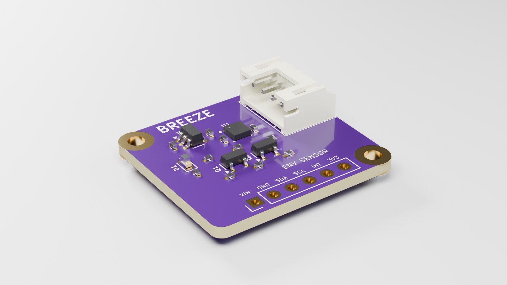
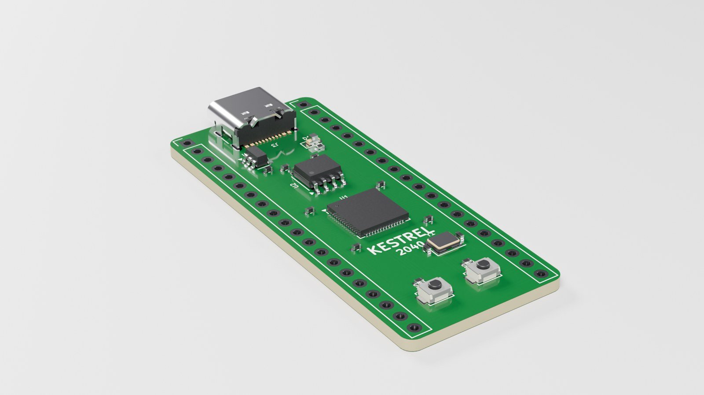

# PCB Product Studio Lite

Free Lite edition of **PCB Product Studio**, a Blender add-on that turns a circuit board exported as GLB
(for example from KiCad) into a studio product shot in one click.



## What Lite does

- Detects KiCad's exported layers (copper, pads, solder mask, silkscreen, board body) and gives each a realistic material
- Solder mask in green, black or blue; HASL, ENIG or bare-copper pads; crisp silkscreen
- Component materials: plastic, epoxy, ceramic and metal looks
- **Studio soft** lighting with a seamless backdrop
- **Hero 3/4** and **Top-down** auto-framed cameras
- 360° turntable animation
- HD and square render sizes, transparent PNG with shadows, one-click GPU setup

The full version adds 3 more lighting looks (White e-commerce, Dark hero, Tech glow), 3 more cameras
(low angle, front, macro), exploded views, 4 more mask colours and QHD/4K/social sizes:
**https://pcbproductstudio.gumroad.com/l/pcb-product-studio**



## Install

1. Download [`release/pcb_studio_lite-0.1.8.zip`](release/pcb_studio_lite-0.1.8.zip) (or get it from
   [Gumroad](https://pcbproductstudio.gumroad.com/l/lite)). Don't unzip it.
2. In Blender: **Edit → Preferences → Get Extensions → ▼ (top right) → Install from Disk**, then pick the zip.
3. Open the **PCB Studio** tab in the 3D Viewport sidebar (press **N** if it's hidden).

## Use

Export your board from KiCad:

```
kicad-cli pcb export glb -f -o board.glb --subst-models --include-tracks --include-pads \
    --include-zones --include-silkscreen --include-soldermask board.kicad_pcb
```

Then in Blender: **File → Import → glTF 2.0**, select the imported objects, click **Quick product shot**
and press **F12**. The full guide is in [`pcb_studio/README.md`](pcb_studio/README.md).

**Tested on** Blender 4.2 LTS and 5.2, with GLB exports from KiCad 10. Other versions may work but
aren't tested.

## Notes

- Visualization tool only. Renders aren't engineering verification of a PCB design.
- The boards shown are demo boards designed for the showcase.
- The add-on makes no network connections and collects no data.
- Issues and questions: open a GitHub issue, or email pcbproductstudio@gmail.com.

## Licence

GPL-3.0-or-later. See [LICENSE](LICENSE). The renders you make with it are yours.
The name "PCB Product Studio" is not licensed under the GPL; forks should use a different name.

*Not affiliated with or endorsed by the Blender Foundation or the KiCad project.
Blender is a registered trademark of the Blender Foundation.*
